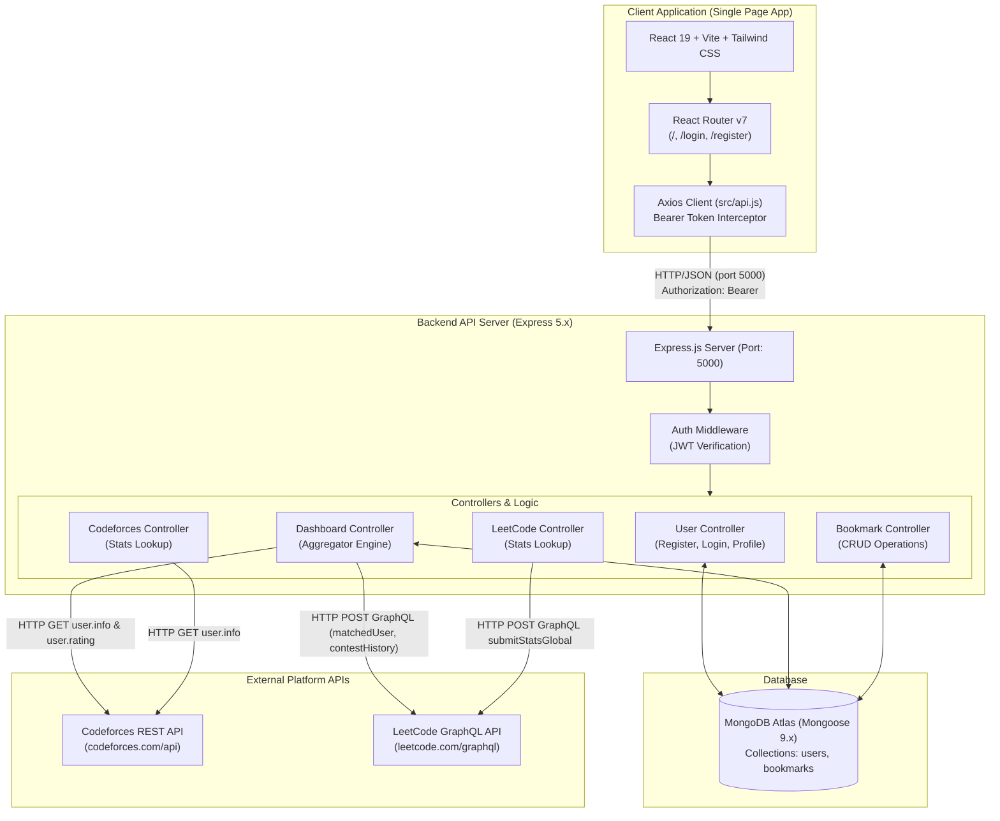
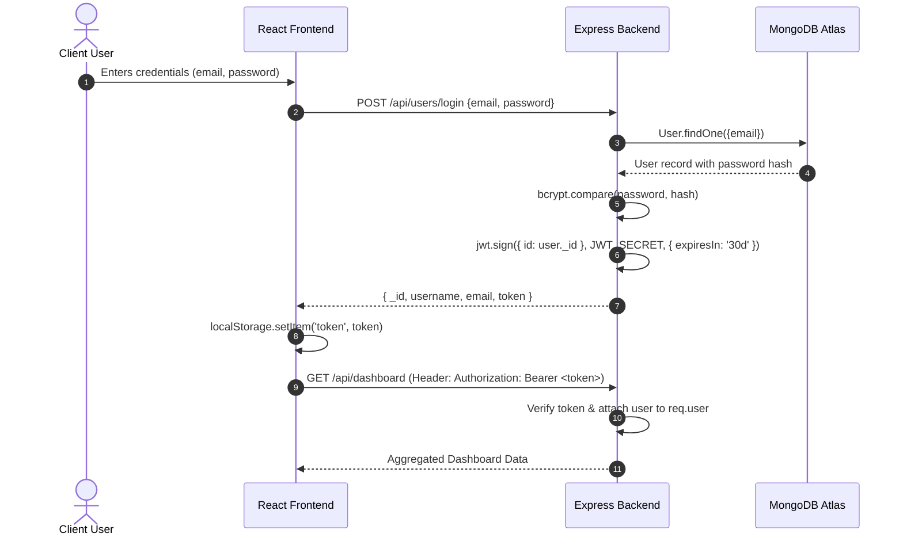
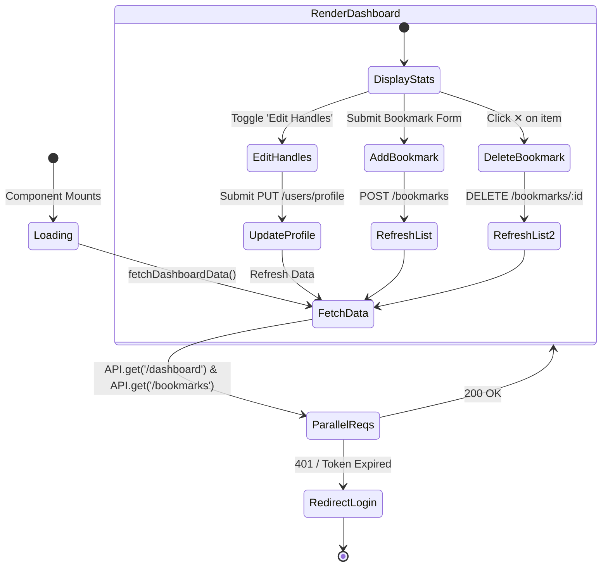

# System Architecture & Technical Specification: CP_Aggregator

> **Project Name:** CP_Aggregator (Competitive Programming Aggregator)  
> **Repository Root:** `CP_Aggregator/`  
> **Last Updated:** 2026-11-15  
> **Target Audience:** AI Models, Autonomous Coding Agents, and Human Developers

---

## 1. Executive Summary & Purpose

**CP_Aggregator** is a full-stack web application designed for competitive programming (CP) enthusiasts. It solves the fragmentation problem in competitive programming by unifying performance metrics and problem tracking from multiple platforms into a single unified dashboard:

- **Performance Tracking:** Pulls user ratings, current ranks, rating history progression (last 15 contests), and solved problem distributions across competitive programming platforms (**Codeforces** and **LeetCode**).
- **Problem Repository / Bookmarking:** Allows users to catalog, categorize, and track individual coding problems with direct links, difficulty ratings, and platform tags.
- **Aggregation Engine:** Consolidates multi-platform API calls and internal database operations using resilient parallel execution (`Promise.allSettled`) to deliver high-performance dashboard summaries without blocking on slow or failing third-party APIs.

---

## 2. High-Level System Architecture

The application adopts a decoupled **Client-Server (REST + GraphQL proxy)** architecture:



---

## 3. Technology Stack & Key Dependencies

### Frontend (`/Client`)
| Layer / Tool | Technology | Version | Purpose |
|---|---|---|---|
| Runtime / Bundler | Vite | ^8.1.1 | Rapid HMR, asset compilation, and dev server |
| Framework | React | ^19.2.7 | Declarative component UI |
| Routing | React Router DOM | ^7.18.1 | Client-side routing and protected view redirects |
| Styling | Tailwind CSS | ^3.4.19 | Utility-first responsive CSS design |
| Visualization | Recharts | ^3.10.0 | Contest rating progression line charts |
| HTTP Client | Axios | ^1.18.1 | HTTP requests with JWT request interceptors |

### Backend (`/Server`)
| Layer / Tool | Technology | Version | Purpose |
|---|---|---|---|
| Runtime | Node.js (CommonJS) | - | Server execution runtime |
| Framework | Express.js | ^5.2.1 | REST routing, middleware chaining |
| Database ODM | Mongoose | ^9.7.4 | MongoDB object modeling and validation |
| Authentication | JSON Web Tokens (`jsonwebtoken`) | ^9.0.3 | Stateless JWT generation and verification |
| Password Security | bcryptjs | ^3.0.3 | Salt generation and password hashing |
| HTTP Client | Axios | ^1.18.1 | Upstream REST & GraphQL queries to Codeforces and LeetCode |
| CORS | cors | ^2.8.6 | Cross-origin resource sharing headers |
| Configuration | dotenv | ^17.4.2 | Environment variable injection |

---

## 4. Directory & File Manifest

```text
CP_Aggregator/
├── Client/                          # Frontend SPA
│   ├── public/                      # Static assets (favicons, svgs)
│   ├── src/
│   │   ├── components/
│   │   │   └── RatingChart.jsx      # Recharts component for rating progression
│   │   ├── pages/
│   │   │   ├── Dashboard.jsx        # Core view: profile stats, charts, bookmarks
│   │   │   ├── Login.jsx            # User sign-in page
│   │   │   └── Register.jsx         # User registration page
│   │   ├── api.js                   # Axios instance configured with base URL & JWT interceptor
│   │   ├── App.jsx                  # Main router setup and view layout
│   │   ├── index.css                # Tailwind directives & base styling
│   │   └── main.jsx                 # React root entry point
│   ├── index.html                   # HTML entry point
│   ├── package.json                 # Client dependencies & scripts
│   ├── tailwind.config.js           # Tailwind content paths & theme extensions
│   └── vite.config.js               # Vite + React plugin configuration
│
└── Server/                          # Backend REST API
    ├── config/
    │   └── db.js                    # Mongoose connection with IPv4 forced resolution (`family: 4`)
    ├── controllers/
    │   ├── bookmarkController.js    # CRUD handlers for problem bookmarks
    │   ├── codeforcesController.js  # Direct Codeforces user info query handler
    │   ├── dashboardController.js   # Main aggregator logic: aggregates CF, LC, & Bookmarks
    │   ├── leetcodeController.js    # Direct LeetCode GraphQL query handler
    │   └── userController.js        # Auth handlers: register, login, get & update profile
    ├── middleware/
    │   └── authMiddleware.js        # JWT header validation and req.user population
    ├── models/
    │   ├── bookmark.js              # Bookmark Mongoose schema & model
    │   └── User.js                  # User Mongoose schema & model
    ├── routes/
    │   ├── bookmarkRoutes.js        # /api/bookmarks route definitions
    │   ├── codeforcesRoutes.js      # /api/codeforces route definitions
    │   ├── dashboardRoutes.js       # /api/dashboard route definitions
    │   ├── leetcodeRoutes.js        # /api/leetcode route definitions
    │   └── userRoutes.js            # /api/users route definitions
    ├── .env                         # Server environment configuration (PORT, MONGO_URI, JWT_SECRET)
    ├── index.js                     # Express app initialization, middleware, route mounting
    └── package.json                 # Server dependencies & scripts
```

---

## 5. Database Architecture & Data Schemas

### 5.1 `User` Schema (`Server/models/User.js`)
Stores account authentication data and linked platform usernames:

```javascript
{
  username: { type: String, required: true, unique: true, trim: true },
  email: { type: String, required: true, unique: true, lowercase: true },
  password: { type: String, required: true },               // Stored as bcrypt hash
  codeforcesHandle: { type: String, default: "" },          // Codeforces username
  leetcodeHandle: { type: String, default: "" },            // LeetCode username
  timestamps: true                                          // createdAt, updatedAt
}
```

### 5.2 `Bookmark` Schema (`Server/models/bookmark.js`)
Stores bookmarked problems linked to a specific user:

```javascript
{
  user: { type: mongoose.Schema.Types.ObjectId, required: true, ref: 'User' },
  platform: { type: String, required: true, enum: ['Codeforces', 'LeetCode'] },
  problemName: { type: String, required: true },
  problemLink: { type: String, required: true },
  difficulty: { type: String, required: false },             // e.g., "1500", "Hard", "Medium"
  status: { type: String, enum: ['To Do', 'Attempted', 'Solved'], default: 'To Do' },
  timestamps: true                                          // createdAt, updatedAt
}
```

> [!WARNING]
> **Schema Inconsistency Note:** In `Client/src/pages/Dashboard.jsx`, the platform dropdown includes `<option value="Other">Other</option>`, but the backend `Bookmark` schema enforces `enum: ['Codeforces', 'LeetCode']`. Submitting a bookmark with `"Other"` will cause Mongoose validation to reject it with a 500 error.

---

## 6. Authentication & Security Flow

1. **Password Encryption:** User registration (`POST /api/users/register`) hashes passwords with `bcryptjs.genSalt(10)`.
2. **Token Generation:** User login (`POST /api/users/login`) compares password hashes using `bcrypt.compare`. On success, signs a JWT containing the user's `_id` with an expiry of `30d`.
3. **Client-Side Storage:** The frontend stores the JWT in browser `localStorage` (`localStorage.setItem('token', response.data.token)`).
4. **Request Interception:** `Client/src/api.js` registers an Axios request interceptor injecting the header `Authorization: Bearer <token>` on all outbound calls.
5. **Route Protection:** Protected routes mount `protect` middleware (`Server/middleware/authMiddleware.js`), which:
   - Extracts the Bearer token.
   - Verifies the signature using `process.env.JWT_SECRET`.
   - Fetches the user from MongoDB omitting password (`.select('-password')`).
   - Attaches the Mongoose document to `req.user`.



---

## 7. API Reference Specification

All endpoints except registration and login require the `Authorization: Bearer <token>` header.

### 7.1 User & Auth Routes (`/api/users`)
- `POST /register`: Registers new user.
  - Body: `{ username, email, password }`
  - Response (201): `{ _id, username, email, message }`
- `POST /login`: Authenticates user.
  - Body: `{ email, password }`
  - Response (200): `{ _id, username, email, token }`
- `GET /profile` `[Protected]`: Returns current user document (minus password).
  - Response (200): `{ _id, username, email, codeforcesHandle, leetcodeHandle }`
- `PUT /profile` `[Protected]`: Updates linked platform handles.
  - Body: `{ codeforcesHandle, leetcodeHandle }`
  - Response (200): Updated user object.

### 7.2 Aggregator Dashboard Route (`/api/dashboard`)
- `GET /` `[Protected]`: The core aggregator endpoint.
  - Operations executed concurrently via `Promise.allSettled`:
    1. MongoDB query: Latest 5 bookmarks (`Bookmark.find({ user: _id }).sort({ createdAt: -1 }).limit(5)`).
    2. Codeforces Info: `GET https://codeforces.com/api/user.info?handles=${codeforcesHandle}`
    3. Codeforces History: `GET https://codeforces.com/api/user.rating?handle=${codeforcesHandle}`
    4. LeetCode GraphQL: `POST https://leetcode.com/graphql` for submission stats and contest history.
  - Response (200):
    ```json
    {
      "user": {
        "username": "coder1",
        "email": "coder1@example.com",
        "codeforcesHandle": "tourist",
        "leetcodeHandle": "neal_wu"
      },
      "recentBookmarks": [ /* Array of up to 5 Bookmark objects */ ],
      "codeforces": {
        "rating": 3979,
        "rank": "legendary grandmaster",
        "maxRating": 4009,
        "ratingHistory": [
          { "contestName": "Codeforces Round 900", "rating": 3950 }
        ]
      },
      "leetcode": {
        "totalSolved": 1250,
        "easy": 400,
        "medium": 650,
        "hard": 200,
        "ratingHistory": [
          { "contestName": "Weekly Contest 380", "rating": 2840 }
        ]
      }
    }
    ```

### 7.3 Bookmark Routes (`/api/bookmarks`)
- `POST /` `[Protected]`: Creates a problem bookmark.
  - Body: `{ platform, problemName, problemLink, difficulty, status }`
  - Response (201): Created bookmark document.
- `GET /` `[Protected]`: Retrieves all bookmarks for the user.
  - Response (200): Array of bookmarks sorted descending by `createdAt`.
- `DELETE /:id` `[Protected]`: Deletes bookmark by ID (verifies ownership `user: req.user._id`).
  - Response (200): `{ message: "Bookmark deleted successfully" }`

### 7.4 Dedicated Platform Routes
- `GET /api/codeforces/stats` `[Protected]`: Returns `{ platform, handle, rating, rank }`.
- `GET /api/leetcode/stats` `[Protected]`: Returns `{ platform, handle, problemsSolved: { all, easy, medium, hard } }`.

---

## 8. External Integrations & Query Design

### 8.1 Codeforces API
- **Protocol:** Public REST API.
- **Endpoints:**
  - User details: `https://codeforces.com/api/user.info?handles=<handle>`
  - Contest rating history: `https://codeforces.com/api/user.rating?handle=<handle>`
- **Transformation:** Slices the last 15 contests (`rawHistory.slice(-15)`) to map `contestName` and `newRating` into chart-friendly formats.

### 8.2 LeetCode API
- **Protocol:** GraphQL over HTTPS POST (`https://leetcode.com/graphql`).
- **Headers:** Requires a simulated browser `User-Agent: Mozilla/5.0` to avoid automated scrapers/bot blocking.
- **GraphQL Query:**
  ```graphql
  query getUserData($username: String!) { 
      matchedUser(username: $username) { 
          submitStats: submitStatsGlobal { 
              acSubmissionNum { difficulty count } 
          } 
      }
      userContestRankingHistory(username: $username) {
          attended
          rating
          contest {
              title
          }
      }
  }
  ```
- **Transformation:** Filters for attended contests (`contest.attended`), rounds ratings to integers (`Math.round(contest.rating)`), and slices the last 15 contests.

---

## 9. Frontend Architecture & UI Workflow

### 9.1 Router & Page Flow
- `/login`: Form for email/password. Saves token and redirects to `/`.
- `/register`: Form for username/email/password. Redirects to `/login`.
- `/`: Protected Dashboard. If no token exists or requests fail with 401, clears localStorage and redirects to `/login`.
- `/*`: Wildcard redirect to `/`.

### 9.2 Dashboard Lifecycle (`Client/src/pages/Dashboard.jsx`)


### 9.3 Data Visualization Component (`RatingChart.jsx`)
- Uses `recharts` (`ResponsiveContainer`, `LineChart`, `Line`, `XAxis`, `YAxis`, `Tooltip`, `CartesianGrid`).
- Hides crowded XAxis text labels (`tick={false}`) while surfacing the contest name in the interactive tooltip.
- Dynamically bounds the Y-axis using `domain={['dataMin - 50', 'dataMax + 50']}` for visual clarity.

---

## 10. Environment & Configuration Guide

### Server Environment Variables (`Server/.env`)
| Variable | Description | Example / Current Setting |
|---|---|---|
| `PORT` | Local port Express listens on | `5000` |
| `MONGO_URI` | MongoDB Atlas / replica connection string | `mongodb://<user>:<pwd>@<cluster>.mongodb.net/...` |
| `JWT_SECRET` | Secret key used for signing JWTs | `super_secret_string_only_the_server_knows_123` |

### Database Connection Configuration
In `Server/config/db.js`, `mongoose.connect` is configured with:
```javascript
mongoose.connect(process.env.MONGO_URI, { family: 4 });
```
> [!NOTE]
> `{ family: 4 }` forces Node.js DNS resolution to use IPv4 instead of IPv6. This avoids common connection timeout errors on WSL2 and certain cloud MongoDB Atlas clusters.

---

## 11. Known Edge Cases, Caveats & Engineering Notes for Future Agents

1. **Enum Mismatch in Bookmarks:**
   - Client dropdown has options: `['Codeforces', 'LeetCode', 'Other']`.
   - Server Mongoose schema has enum: `['Codeforces', 'LeetCode']`.
   - **Fix needed:** Either add `'Other'` to `Server/models/bookmark.js` or remove it from `Client/src/pages/Dashboard.jsx`.

2. **Middleware Control Flow in `authMiddleware.js`:**
   - If token is missing, the code runs `res.status(401).json(...)` after checking `if (!token)`, but lacks a `return` statement in the `catch` block on verification errors, which could attempt double response transmission if downstream errors occur.

3. **External Rate Limits & Bot Protection:**
   - LeetCode's GraphQL endpoint has no official public SLA and periodically adjusts Cloudflare rate limits. The current code includes a custom `User-Agent` header to mitigate blocking, but upstream schema updates or IP blocks may occur under heavy polling.

4. **Dashboard Bookmarks vs. Full Bookmarks:**
   - `/api/dashboard` returns the 5 most recent bookmarks in `recentBookmarks`.
   - The React Dashboard page concurrently calls `GET /api/bookmarks` and overrides `data.bookmarks` with the full list. Both endpoints are operational.
